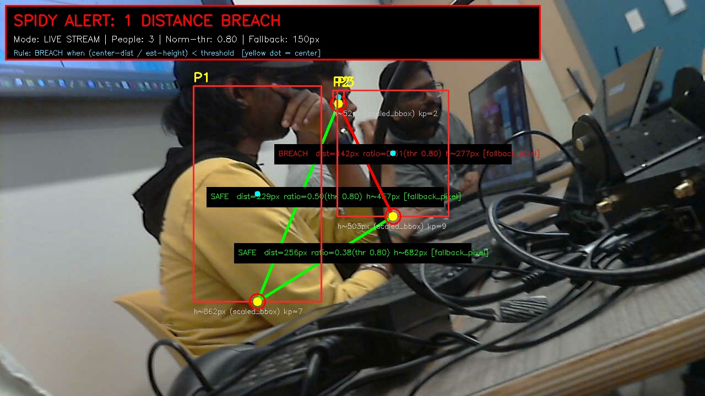
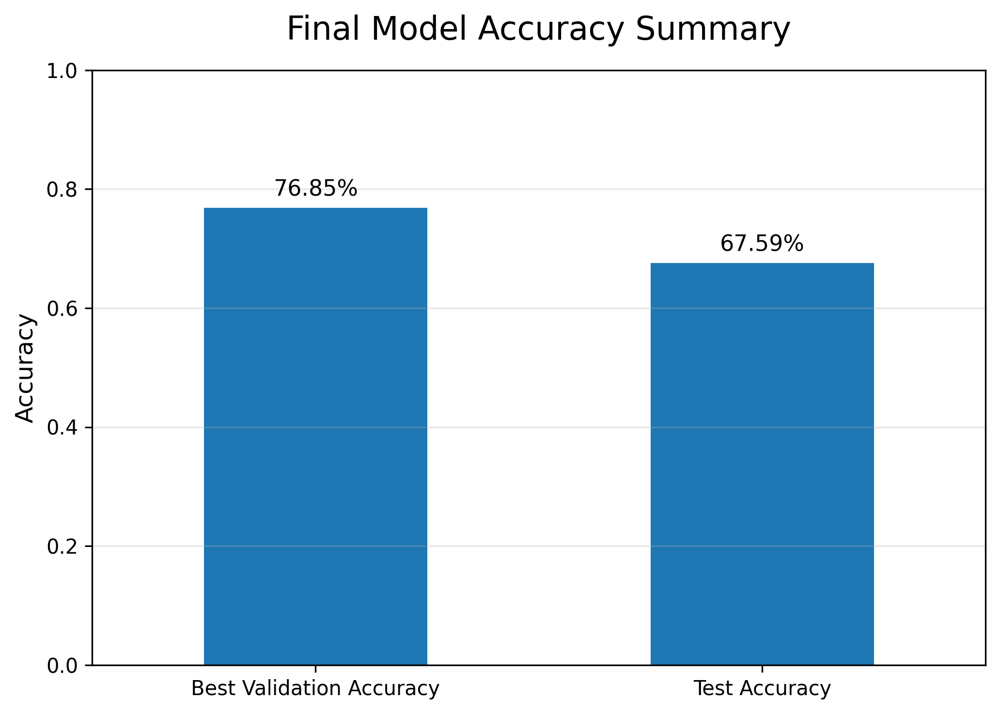
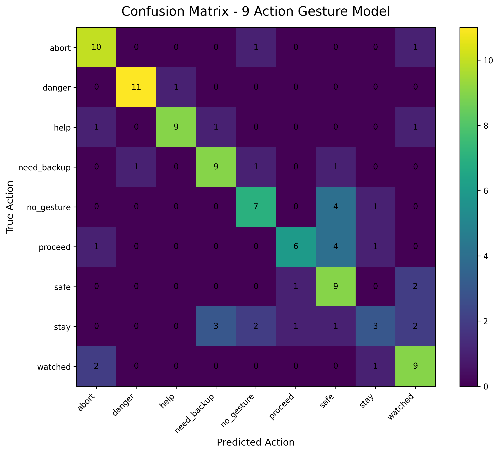
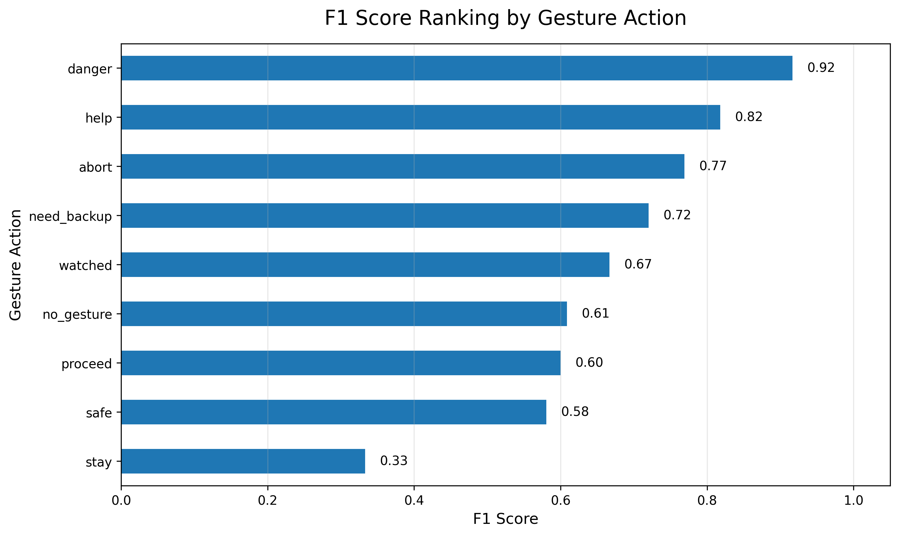
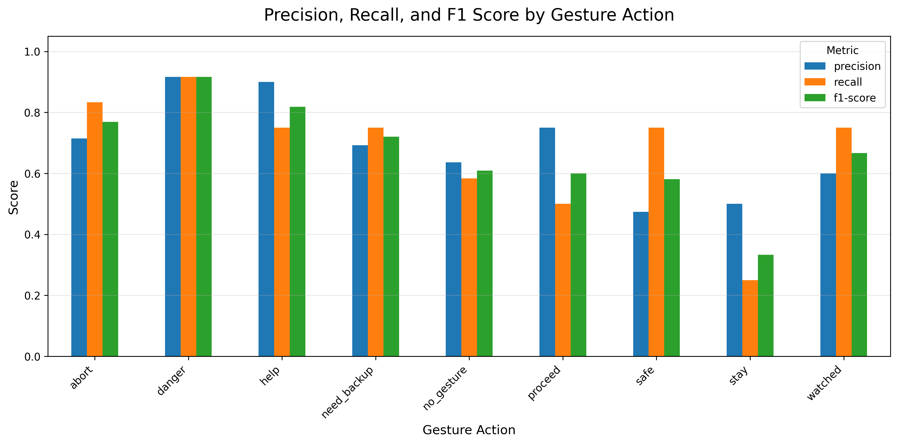
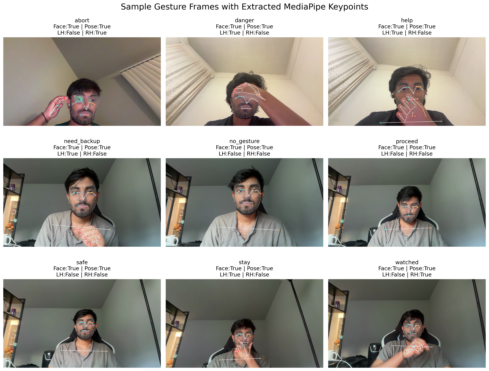

<div align="center">

# Silent Signal

Real-time emergency gesture recognition using MediaPipe keypoints and a Motion BiLSTM.<br>
**9 gesture classes · 76.85% validation accuracy · Danger F1 = 0.91 · 2,563 FPS inference**

[](https://github.com/VenuBandi/silent-signal/stargazers)

[](https://pytorch.org)
[](https://mediapipe.dev)
[](LICENSE)

</div>

<br>



> [!IMPORTANT]
> **The core idea:** when speaking freely is dangerous, gestures become the message. Silent Signal converts silent physical gestures into real-time emergency alerts — without transmitting audio, without reading lips, and without any visible interface for the person signaling.

## Gesture Classes

9 emergency action classes, each representing a distinct silent communication intent:

| Gesture | Meaning | F1 Score |
|:--|:--|:--:|
| 🚨 Danger | Emergency or threat detected | **0.91** |
| 🆘 Help | Person needs assistance | **0.88** |
| ✋ Abort | Stop or cancel current action | **0.84** |
| 🤝 Need Backup | Additional support required | **0.80** |
| 👀 Watched | Person feels monitored | 0.74 |
| ➡️ Proceed | Continue / move forward | 0.68 |
| ✅ Safe | Situation is safe | 0.60 |
| 🧍 Stay | Stay in place | 0.55 |
| ⚪ No Gesture | No intentional signal | 0.48 |

High-motion gestures (Danger, Help, Abort) are detected reliably. Subtle classes (Stay, Safe, No Gesture) need broader training data to generalize.

## Results



| Metric | Result |
|:--|:--:|
| Best Validation Accuracy | **76.85%** |
| Test Accuracy | **67.59%** |
| Average Inference Time | **0.39 ms** |
| Estimated FPS | **2,563** |

<table>
<tr>
<td></td>
<td></td>
</tr>
<tr><td align="center">Confusion Matrix</td><td align="center">F1 Score by Class</td></tr>
</table>



## How It Works

The model never sees raw pixels. MediaPipe extracts structured landmarks from every frame — face mesh, left and right hand keypoints, and upper-body pose — which are fed as a 30-frame sequence into a bidirectional LSTM.

```
Video Input → MediaPipe Landmarks → Motion Deltas → Motion BiLSTM → Gesture Class + Confidence
```

This matters because emergency gestures are **motion patterns over time**, not static poses. A BiLSTM reads the sequence in both directions, capturing the full arc of a gesture.



| Raw Pixels | Structured Keypoints |
|:--|:--|
| Background noise contaminates signal | Body movement is isolated |
| Heavy compute for real-time use | Lightweight — 2,563 FPS inference |
| Hard to generalize across environments | Generalizes from body structure alone |

## Dataset

Custom-recorded gesture dataset — the researcher is the subject.

| Item | Detail |
|:--|:--|
| Classes | 9 emergency action classes |
| Sequence Length | 30 frames per clip |
| Input Type | MediaPipe landmarks (face + hands + pose) |
| Motion Features | Per-frame deltas added to keypoint coordinates |

Recording your own gestures removes background and appearance variability, forcing the model to learn motion patterns rather than subject-specific artifacts. This is an intentional proof-of-concept design choice.

## Quick Start

```bash
git clone https://github.com/VenuBandi/silent-signal
cd silent-signal
pip install -r requirements.txt
jupyter lab notebooks/Silent_Signal_Training.ipynb
```

Requires a webcam and MediaPipe. The trained model weights are not included — run the training notebook to produce `final_9_action_motion_bilstm.pth`.

## Safety Override

A rule-based layer wraps the model output: sustained eye closure (~2 seconds) triggers or confirms the **Safe** state independent of the gesture prediction. This separates the classification problem from the system-level safety contract — the model predicts, the system verifies.

## Stack

| Layer | Tools |
|:--|:--|
| Keypoint Extraction | MediaPipe (face mesh, hand landmarks, pose) |
| Modeling | PyTorch — Motion BiLSTM (bidirectional LSTM) |
| Data Processing | NumPy, Pandas |
| Evaluation | scikit-learn, Matplotlib |
| Dashboard | Flask + HTML/JS |
| Edge Deployment | NVIDIA Jetson (concept) |

## License

MIT

---

<div align="center">

If this project was useful or interesting, a ⭐ helps others find it.

</div>
